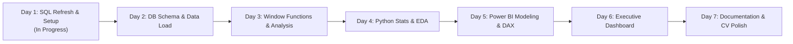

# 📊 End-to-End E-Commerce Sales & Customer Retention Analysis

[](https://www.postgresql.org/)
[](https://www.python.org/)
[](https://pandas.pydata.org/)
[](https://powerbi.microsoft.com/)
[](LICENSE)

An enterprise-grade, end-to-end data analytics project examining **~100,000 real-world customer orders** from the [Brazilian E-Commerce Public Dataset by Olist](https://www.kaggle.com/datasets/olistbr/brazilian-ecommerce). This project covers the full data analytics lifecycle: **relational database architecture (PostgreSQL)**, **statistical exploratory data analysis (Python/Pandas/Scipy)**, **dimensional modeling & DAX (Power BI)**, and **commercial decision-making storytelling**.

---

## 🎯 Project Overview & Objectives

E-commerce businesses face intense competition where logistics efficiency directly dictates customer retention and lifetime value (LTV). This project investigates:
1. **Sales & Growth Trajectory:** Monthly revenue trends and month-over-month growth rates.
2. **Product Performance:** High-margin category leaders vs underperforming segments.
3. **Logistics & Delivery Bottlenecks:** Quantification of delivery delays vs customer satisfaction.
4. **Statistical Hypothesis Validation:** Demonstrating whether delivery delays cause statistically significant drops in review ratings.
5. **Executive KPI Dashboard:** Providing C-suite and supply chain leadership with an interactive control tower.

---

## 🗂️ Project Directory Structure

```text
ecommerce-sql-powerbi-analysis/
├── README.md                           # Executive summary and portfolio documentation
├── ROADMAP.md                          # 7-Day action tracker & milestone checklist
├── .gitignore                          # Git ignore rules (excluding large CSVs)
├── data/                               # Dataset directory (see data/README.md)
│   └── README.md
├── sql/                                # PostgreSQL schemas and analytical queries
│   ├── 00_pgexercises_day1_refresh.sql # Day 1: SQL syntax exercises & reference
│   └── 01_schema_setup.sql             # Day 2: Relational DDL & index definitions
├── notebooks/                          # Jupyter Notebooks for statistical analysis
│   └── README.md
├── powerbi/                            # Power BI reports and DAX definitions
│   └── README.md
└── images/                             # Exported charts, diagrams, and dashboard views
    └── .gitkeep
```

---

## 📅 7-Day Action Roadmap & Current Progress



| Day | Focus Area | Status | Key Deliverable |
|:---:|:---|:---:|:---|
| **Day 1** | **SQL Syntax Refresh & Setup** | 🟡 **In Progress** | Completed pgexercises basic queries; repo initialized |
| **Day 2** | **Database Design & Data Loading** | ⚪ *Planned* | `01_schema_setup.sql`, PostgreSQL import of 8 CSVs |
| **Day 3** | **Exploratory SQL & Window Functions** | ⚪ *Planned* | `02_business_analysis.sql` with 6 business queries |
| **Day 4** | **Python (pandas) Data Cleaning & Stats** | ⚪ *Planned* | `03_statistical_eda.ipynb`, hypothesis test, seaborn charts |
| **Day 5** | **Power BI Data Modeling & DAX** | ⚪ *Planned* | Star schema model, core DAX calculated measures |
| **Day 6** | **Power BI Dashboard Design** | ⚪ *Planned* | Single-page Executive Sales & Logistics Dashboard |
| **Day 7** | **GitHub Documentation & CV Polish** | ⚪ *Planned* | Comprehensive README, executive summary, CV bullet points |

---

## 🚀 Day 1 Progress: SQL Foundations & Syntax Refresh

Completed practice exercises on [PostgreSQL Exercises (pgexercises.com)](https://pgexercises.com) covering core SQL primitives:
- [x] **Full Table Scans:** `SELECT * FROM cd.facilities;`
- [x] **Column Projection:** `SELECT name, membercost FROM cd.facilities;`
- [x] **Row Filtering:** `WHERE membercost > 0;`
- [x] **Compound Predicates & Arithmetic:** `WHERE membercost > 0 AND (membercost < monthlymaintenance / 50.0);`
- [x] **Pattern Matching:** `WHERE name LIKE '%Tennis%';`
- [x] **Set Inclusions:** `WHERE facid IN (1, 5);`

All exercise solutions and preview queries are documented in [`sql/00_pgexercises_day1_refresh.sql`](file:///c:/Users/Test/Desktop/sql/sql/00_pgexercises_day1_refresh.sql).

---

## 🛠️ Tech Stack & Skills Demonstrated

- **Database:** PostgreSQL (Multi-table `JOIN`s, `GROUP BY`, CTEs, `CASE WHEN`, Window Functions `ROW_NUMBER()`, `RANK()`, `LAG()`).
- **Python:** `pandas`, `numpy`, `scipy.stats` (Mann-Whitney U / t-test), `matplotlib`, `seaborn`, `SQLAlchemy`.
- **Business Intelligence:** Microsoft Power BI Desktop (Power Query ETL, Star Schema dimensional modeling, DAX `CALCULATE`, `DIVIDE`, `SUM`).
- **Data Storytelling:** Translating raw operational anomalies into actionable commercial strategy.

---

## 📄 License
This project is open-source under the MIT License.
